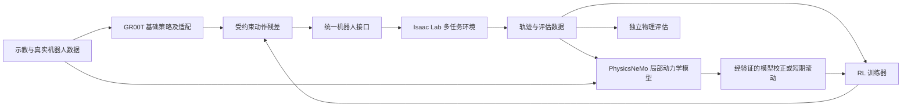

# 通用机器人基础模型 × PhysicsNeMo × RL：研究平台 TODO

更新日期：2026-11-03

状态：研究与实施计划；勾选项仅表示已有证据的本地工作。

目标：建立可复用的多任务、多机器人学习与评估平台，让基础策略、物理模型和 RL 可以独立替换、组合、比较。

SO-101 抓取入槽作为第一项回归任务。平台随后扩展到其他操作任务和机器人，分别验证任务泛化与跨机器人适配能力。

## 技术分工与两条研究路线

| 组件 | 职责 | 首轮用途 |
| --- | --- | --- |
| NVIDIA Isaac GR00T | 视觉、语言、机器人状态到动作的基础策略 | 选定 checkpoint，适配观测与动作，建立基线 |
| Isaac Sim / Isaac Lab | 物理执行、并行环境、传感器、奖励与评估 | 多任务采样、扰动训练与独立物理评估 |
| PhysicsNeMo | 学习执行器响应、局部动力学与模型残差 | 先做执行器模型，再评估短期模型辅助 RL |
| RL trainer | 策略优化、采样与检查点管理 | 先训练受约束的 Residual policy |
| RLinf | VLA 的 RL 后训练候选集成 | 在兼容的 Linux 环境复现官方示例后接入自定义任务 |
| LeRobot / 数据适配器 | 示教、实机数据与 episode 管理 | 统一训练数据格式和机器人接口 |

GR00T 的代码和模型权重分别核对许可证；代码开放不意味着权重使用相同许可证。[GR00T 仓库](https://github.com/NVIDIA/Isaac-GR00T)、[模型卡](https://huggingface.co/nvidia/GR00T-N1.7-3B)。

PhysicsNeMo 提供 Physics-ML 模型与训练组件；本计划中 RL 的环境、奖励、策略更新和模型接口需要单独接通。它与 NeMo RL 是不同项目。[PhysicsNeMo 文档](https://docs.nvidia.com/physicsnemo/latest/index.html)、[NeMo RL 文档](https://docs.nvidia.com/nemo/rl/latest/index.html)。

- **路线 A，优先实施：** 冻结 GR00T → 训练小型动作残差 → 加入 PhysicsNeMo 执行器/动力学模型 → 多任务对照实验。
- **路线 B，后续对照：** 复现 Isaac Lab + RLinf 的 VLA 后训练 → 适配自定义任务 → 比较直接微调与残差方案的收益、遗忘和算力成本。

Isaac Lab 已提供 RLinf VLA 后训练的实验性流程；该流程当前要求 Linux。实施时锁定其指定依赖与模型版本，不能把文档可用等同于本地 Windows 已兼容。[官方集成文档](https://isaac-sim.github.io/IsaacLab/main/source/experimental-features/rlinf_vla_posttraining.html)。

## 已有起点

以下记录来自本地 SO-101 项目的验证文件，未代表通用学习平台已经完成。本仓库仅发布研究计划；相关仿真资产和原始验证日志未随本次发布。

- [x] 官方 SO-101 机器人资产、参数化任务几何与 USD 场景已建立。
- [x] 300 帧原生物理抓取、抬升与入槽运行通过本地验证，保存了接触和轨迹数据。
- [x] USD 时间采样与 300 帧视频通过本地验证。
- [ ] 接入 GR00T、PhysicsNeMo、Isaac Lab 训练环境和学习策略。
- [ ] 完成真实机器人标定与 Sim2Real 对照。

已有记录：方块最高 Z = 0.140151 m，最终 XYZ ≈ [0.181772, -0.079295, 0.022000] m；采用预设轨迹和 PD 驱动。碰撞代理、摩擦和驱动参数仍需实测标定。原始证据位于本地 `workspace_sim/so101_task/logs/delivery_validation.json` 与 `simulation_validation.json`。

## M0 · 锁定实验与运行环境（P0）

- [ ] 记录 GPU、显存、驱动、OS、Python、CUDA/PyTorch、Isaac Sim/Lab、GR00T 与 PhysicsNeMo 的兼容组合。
- [ ] 为仿真、策略推理、动力学训练分别建立环境与锁文件；明确本地 Windows 和 Linux 训练节点的职责。
- [ ] 固定源码 commit、模型 revision、数据集版本与许可证来源。
- [ ] 建立统一运行配置：机器人、任务、策略、动力学模型、随机种子、预算、数据划分。
- [ ] 测量纯仿真、GR00T 推理、小型 RL、PhysicsNeMo 训练的峰值显存与吞吐，再决定并发方式。
- [ ] 训练预算与成功判定在实验前写入配置；算力不足时采用分进程或远程推理/训练。
- [ ] 保存代码与配置到 Git，权重、数据集、视频和大型 USD 使用独立制品存储并记录哈希。

**交付物：** 环境锁文件、兼容矩阵、实验配置模板、资源基准报告。

**验收：** 新环境可按说明复现一个仿真 episode 和模型推理；配置、版本、输出可追溯。记录数值容差，不承诺 GPU 仿真逐位确定性。

## M1 · 定义跨机器人、跨任务接口（P0）

- [ ] 实现 `RobotAdapter`、`TaskEnv`、`PolicyAdapter`、`DynamicsModel` 和 episode recorder 的接口契约。
- [ ] 统一米、秒、弧度、坐标系、关节顺序、四元数顺序、相机内外参和时间戳。
- [ ] 动作明确区分关节位置/增量、末端位姿/增量、夹爪开度；保存物理单位、归一化与反归一化规则。
- [ ] 定义基础策略动作块长度、重规划频率、残差更新频率、执行器频率与物理步长。
- [ ] 对异步推理定义动作有效期、延迟、丢帧与超时处理；记录实际执行动作。
- [ ] episode 重置时丢弃旧动作块，清空策略历史与残差缓存；覆盖动作块执行中发生自动 reset 的情况。
- [ ] 残差只作用于同一动作表示：平移/关节量按定义相加，旋转按合法旋转复合，夹爪单独映射。
- [ ] 区分部署可观测量与仿真特权状态；策略输入和价值函数输入分别声明。
- [ ] 为 SO-101 处理五轴机械臂加夹爪的可达性、限位与 IK；第二机器人使用独立映射。

**交付物：** schema、适配器接口、坐标与动作往返转换检查。

**验收：** 相同 episode 可正确记录和回放；无关节顺序、单位、时间错位；更换机器人无需改训练器核心。

## M2 · 建立多任务数据与评估基线（P0）

- [ ] 定义至少三个任务族：抓取放置、推移对齐、接触引导入槽；每个任务提供 reset、奖励、终止和成功条件。
- [ ] 将 SO-101 现有脚本控制器接入统一接口，保留可复现的物理回归场景。
- [ ] 增加位置、物体尺寸、质量、摩擦、执行器延迟和相机扰动；区分训练范围与留出范围。
- [ ] 记录图像、语言任务、关节状态、命令、实际动作、物体状态、接触、奖励和失败原因。
- [ ] 按 episode、物体实例、场景、采集批次划分 train/validation/test，避免相邻帧泄漏。
- [ ] 只用训练数据拟合归一化统计与动力学模型；验证集选参数，测试集保留最终评估。
- [ ] 建立脚本控制器、简单模仿学习或小型状态策略基线，量化问题难度。
- [ ] 固定评估协议：首轮建议 3 个训练种子，每个任务每种子 100 个独立评估 episode；预算不足时预先记录缩减方案。

**交付物：** 任务注册表、数据清单、划分文件、批量评估器与基线报告。

**验收：** 成功由物理状态和持续稳定条件判定；记录成功率、置信区间、失败类型和控制代价。视频作为辅助证据。

## M3 · GR00T 基础策略接入（P1，依赖 M0–M2）

- [ ] 选择明确的 GR00T checkpoint，核对其 embodiment、图像输入、状态维度与动作表示。
- [ ] 实现数据转换与推理适配；验证动作块调度、状态历史与相机同步。
- [ ] 在原支持环境复现基础推理，再在目标机器人完成限幅后的闭环仿真。
- [ ] 测量端到端延迟、峰值显存、任务成功率和分布外失败。
- [ ] 按需要收集示教并适配新 embodiment，单独记录适配数据量、训练时间与人工修改。
- [ ] 冻结一个有明确版本的多任务基础策略，供后续残差与动力学实验使用。

**交付物：** GR00T adapter、数据转换器、推理基准、冻结 checkpoint 清单。

**验收：** 从图像/状态到实际执行动作的链路可复现；零样本结果与适配后结果分别报告。

## M4 · PhysicsNeMo 局部物理模型（P1，依赖 M1–M2）

- [ ] 首先定义执行器响应模型：输入关节位置/速度、历史命令、驱动目标、负载和时间步；输出下一步状态或动力学残差。
- [ ] 采集不同速度、负载、延迟和方向切换的数据；将仿真数据与实测数据来源分开标记。
- [ ] 建立解析 PD/延迟模型和小型 MLP 基线，再用 PhysicsNeMo 组件训练候选模型。
- [ ] 测量单步误差与多个短期滚动长度的误差，按机器人、负载和接触状态分组报告。
- [ ] 加入模型集成或其他不确定性估计，验证不确定性与实际预测误差的关系。
- [ ] 仅在单机器人局部模型有效后，研究 GNN 的机器人结构编码、跨机器人迁移与接触模型。
- [ ] 明确模型输出的使用位置：替换执行器响应、校正状态预测或提供短期 imagined rollout；防止重复施加动力学。

**交付物：** 数据集、训练配置、局部动力学 checkpoint、误差与 OOD 报告。

**验收：** 在未参与拟合的轨迹上优于预定简单基线；误差和推理开销达到实验前约定阈值。仅在仿真数据上拟合的模型不能声称缩小了真实差距。

## M5 · Residual RL 与模型辅助 RL（P1）

无模型残差训练依赖 M2–M3，可与 M4 并行；模型辅助阶段再依赖 M4。

- [ ] 先固定基础策略，在原生物理环境训练小型残差策略，设定残差幅度、速度与动作变化约束。
- [ ] 显式给残差策略提供即将执行的基础动作及所需历史，避免修正已经过期的动作块。
- [ ] 选择与动作及采样机制兼容的 RL 算法，验证奖励、终止、reset 和 checkpoint 恢复。
- [ ] 第一阶段只接入已验证的执行器模型，评估训练鲁棒性与原生物理评估表现。
- [ ] 第二阶段研究短期模型滚动，限制起始状态分布、滚动长度与合成样本比例。
- [ ] 按不确定性或分布外检测回退到原生物理采样，监测策略利用模型误差的问题。
- [ ] 分别报告原生环境步数、模型生成步数、基础策略推理调用、训练 GPU 时间和总墙钟时间。

**交付物：** residual trainer、动力学集成配置、消融结果与失败轨迹。

**验收：** 收益在独立原生物理测试中成立；控制抖动、动作饱和、碰撞和遗忘均纳入评估。模型内奖励上升不能单独证明改进。

## M6 · 直接 VLA RL 后训练对照（P2，依赖 M0、M2–M3）

- [ ] 在隔离的 Linux 环境检查 Isaac Lab + RLinf 文档与当前固定版本的兼容性。
- [ ] 先复现官方任务和模型组合，再添加自定义任务与观测/动作映射。
- [ ] 确认选定 GR00T 动作生成方式与 RL 训练目标的兼容实现，避免套用不匹配的策略概率接口。
- [ ] 对比冻结基础策略、残差训练、直接后训练；记录可训练参数、数据、算力和适配成本。
- [ ] 在未用于微调的任务上评估能力遗忘；必要时引入示教混合或保留能力约束。

**交付物：** 官方示例复现记录、自定义任务接入、VLA 后训练对照报告。

**验收：** 优化过程、检查点恢复和闭环评估均有效；与路线 A 在公开记录的预算下比较。

## M7 · 泛化、真实数据与复用验证（P2，依赖 M5；M6 可并行）

- [ ] 分开评估新物体、新场景、新动力学、新任务和新机器人；注明哪些维度为训练内或训练外。
- [ ] 增加第二机器人，复用数据/策略/任务协议；报告新增适配数据与人工工作量。
- [ ] 接入实测零位、限位、相机、延迟、回差、负载响应与材料摩擦数据。
- [ ] 逐步完成实机回放和闭环实验，保存命令、实测响应、失败与干预记录。
- [ ] 将真实失败加入后续训练数据，保持最终评估集独立。
- [ ] 按任务分别报告 sim/real 成功率差距与不确定性，不能用单次成功演示推断通用性。

**交付物：** 泛化矩阵、校准记录、sim/real 对照、可复用接入指南。

**验收：** 至少三个任务族完成统一评估，第二机器人完成接入验证，结论可追溯到配置与 episode。

## 首轮消融矩阵

| 实验 | 基础策略 | 残差 RL | PhysicsNeMo 模型 | 用途 |
| --- | --- | --- | --- | --- |
| A | 冻结 | 无 | 无 | 基础策略基线 |
| B | 冻结 | 有 | 无 | 测量残差训练收益 |
| C | 冻结 | 有 | 执行器/局部校正 | 测量物理模型贡献 |
| D | 冻结 | 有 | 校正 + 短期模型滚动 | 测量模型辅助采样收益 |
| E | 直接 RL 后训练 | 无 | 无 | 与 VLA 微调路线对照 |

主比较固定任务、数据划分、评估 episode 与原生环境交互预算；额外报告所有离线数据、预训练来源和总算力。收益阈值在运行前设定。若未观察到改善，保留负结果及原因。

## 下一轮最先做的五件事

- [ ] 完成 M0 的版本与资源基准，决定 Linux 训练环境。
- [ ] 写出 observation/action/time schema 和 SO-101 adapter。
- [ ] 将现有 SO-101 物理任务转成可 reset/step 的批量环境，加入两个任务族。
- [ ] 跑通 GR00T 推理闭环并锁定基础策略基线。
- [ ] 采集执行器响应数据，建立简单动力学基线与首个 PhysicsNeMo 模型。

## 参考入口

- [Isaac GR00T 源码与使用说明](https://github.com/NVIDIA/Isaac-GR00T)
- [GR00T N1.7 模型卡与权重许可](https://huggingface.co/nvidia/GR00T-N1.7-3B)
- [PhysicsNeMo 源码](https://github.com/NVIDIA/physicsnemo)
- [PhysicsNeMo 文档](https://docs.nvidia.com/physicsnemo/latest/index.html)
- [Isaac Lab 执行器接口](https://isaac-sim.github.io/IsaacLab/main/source/concepts/actuators.html)
- [Isaac Lab：RLinf VLA 后训练](https://isaac-sim.github.io/IsaacLab/main/source/experimental-features/rlinf_vla_posttraining.html)
- [LeRobot SO-101](https://huggingface.co/docs/lerobot/so101)
- [NeMo RL 文档](https://docs.nvidia.com/nemo/rl/latest/index.html)

本文件是集成计划。实际版本、模型兼容性和资源需求以执行时锁定的环境与实验记录为准。
